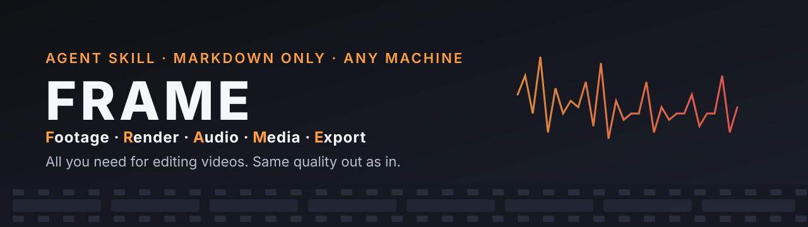
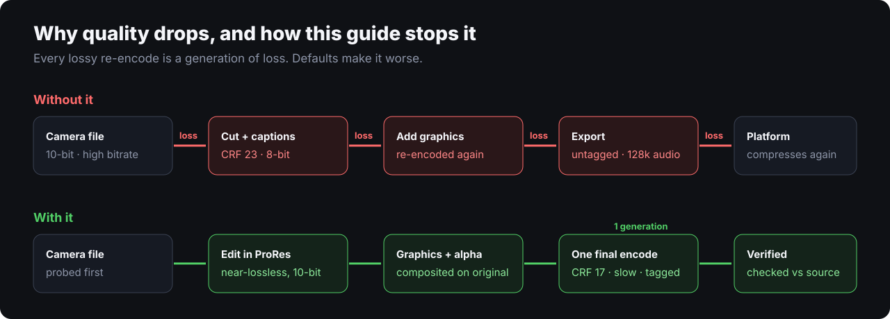
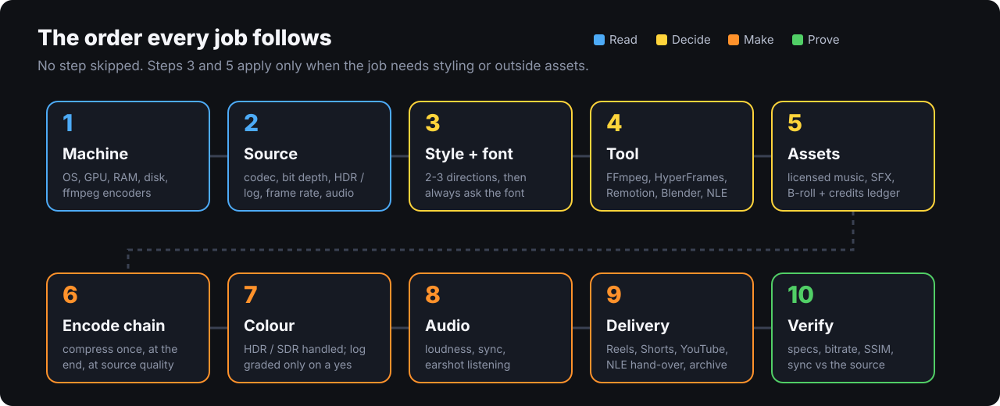
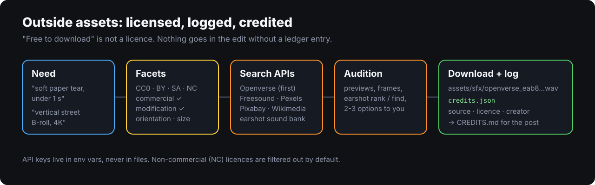

<p align="center"></p>

# FRAME

**Footage · Render · Audio · Media · Export** — all you need for editing videos.

A guide-only skill for AI agents (Claude Code, Claude, and any agent that reads skills) that edit or render video.

It doesn't edit anything. It covers the backend decisions that agents usually get wrong silently: which codec and
quality settings to use, how many times footage gets re-encoded, colour and HDR handling, log footage, frame rates,
audio loudness, which tool fits which job, and how to prove the output matches the source.

Why: agents tend to fall back to library defaults (x264 CRF 23, 8-bit, untagged colour, 128k audio). The result is
the same resolution and half the file size, with visibly worse quality. This guide makes the agent read the machine
and the footage first, then choose settings that keep the source's quality.

<p align="center"></p>

## How it works

<p align="center"></p>

## Outside assets, done legally

<p align="center"></p>

## Find the right style and skill

Two references ship with FRAME so you, or your agent, can pick a style and find an existing skill for the job:

- **[Editing catalog](references/styles/editing-catalog.md):** about 77 sections on effects, techniques, transitions,
  sound, colour, typography, creator frameworks (retention short-form, explainer, documentary…) and genre grammars.
- **[skills.json](references/styles/skills.json)** (data) and **[repos.md](references/styles/repos.md)** (readable):
  427 public video-editing skills and toolkits, with stars, licence and security grade.

| Kind | id | Repos |
|---|---|---|
| 🧱 Frameworks & toolkits | `general` | 73 |
| 📣 Promo & demos | `promo` | 82 |
| 🎓 Explainers | `explainer` | 76 |
| ✂️ Editing | `editing` | 54 |
| 📱 Shorts & social | `shorts` | 52 |
| 🧑‍💼 Avatars | `avatar` | 9 |
| 📖 Stories & animation | `story` | 25 |
| 🎞 Motion graphics | `motion` | 29 |
| 📝 Scripts & learning | `craft` | 10 |
| 🎵 Music videos | `music` | 17 |

```bash
jq -r '.skills[] | select(.kind=="editing" and .security_grade=="safe") | "\(.stars)\t\(.repo_full_name)"' references/styles/skills.json | sort -rn | head
```

Repo list snapshot: 2026-11-05, from [agentskillshub.top](https://agentskillshub.top/best/claude-video-skills/). Check a repo's licence before
copying code: AGPL and unlicensed repos are for ideas only.

## What's inside

```
SKILL.md                  the order every job follows, plus the hard rules
references/
  machine.md              read the machine: OS, GPU, RAM, ffmpeg encoders and filters, load tiers
  source.md               read the footage: codec, bit depth, HDR/log, VFR, colour range
  styles/
    styles.md             choosing an editing style, and how to borrow from other repos safely
    editing-catalog.md    master catalog of editing effects, techniques, creator frameworks (searched, not loaded)
    skills.json           427 public video-skill repos as data: kind, stars, licence, security grade
    repos.md              the same list as readable tables, one per kind
  fonts.md                font selection: always ask, specimen stills, script coverage, licences
  assets/
    README.md             where outside assets come from and the rules for using them
    facets.md             licence facets (CC0/BY/SA/NC/ND, commercial, modification, releases) + search facets
    audio-sources.md      music & SFX: Openverse API first, then Freesound, earshot bank
    visual-sources.md     B-roll & images: Pexels, Pixabay, Openverse, Unsplash, Wikimedia, NASA, museums
    project-folder.md     project folder layout + credits.json ledger
  tools.md                which tool for which job (FFmpeg, auto-editor, HyperFrames/Remotion, Blender, Whisper, NLEs)
  encoding.md             encode chain, intermediates, final codec settings, quality-killer checklist
  colour.md               HDR/SDR handling, gated grading of log footage, still-frame checks
  audio.md                audio handling, loudness targets, earshot (the agent's ears)
  delivery.md             platform targets (Reels/Shorts/TikTok, YouTube, HDR, editor hand-over)
  verify.md               draft → final → verification against the source
docs/images/              README graphics (SVG)
```

No scripts. The agent adapts to whatever machine it runs on: macOS, Windows or Linux; Apple, NVIDIA, Intel, AMD or no
GPU.

## Install

**Claude Code:** copy the folder into `~/.claude/skills/` (personal) or `.claude/skills/` (one project).

```
git clone https://github.com/deepanshutomar/frame ~/.claude/skills/frame
```

**Claude apps:** zip the folder and upload it under Settings → Capabilities → Skills.

Free API keys the asset step can use (optional, set as env vars): `PEXELS_API_KEY`, `PIXABAY_API_KEY`,
`FREESOUND_API_KEY`, `UNSPLASH_ACCESS_KEY`. Openverse works without a key.

Requirements on the machine: `ffmpeg` and `ffprobe`. Optional: `mediainfo`, `exiftool`, `auto-editor`, Whisper,
[earshot](https://github.com/Leonxlnx/earshot) (used by default when installed or approved), Blender,
HyperFrames/Remotion.

## Use

It triggers on its own for any video edit, conversion, grade or export. You can also call it directly:
"/frame, render this for Reels without losing quality."

Other editing skills can rely on it. Add one line to them, such as "Follow the frame skill for every
render, encode and colour decision", and keep their own files free of codec rules.

## Author

Made by **Deepanshu Tomar** · Instagram [@deepanshutomarg](https://instagram.com/deepanshutomarg) &
[@dsedaddy](https://instagram.com/dsedaddy)
